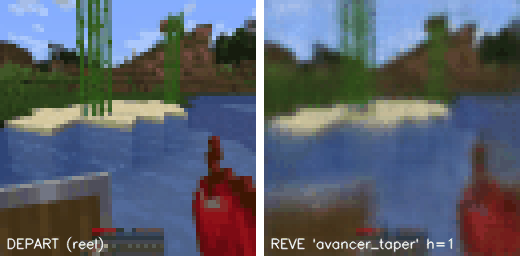
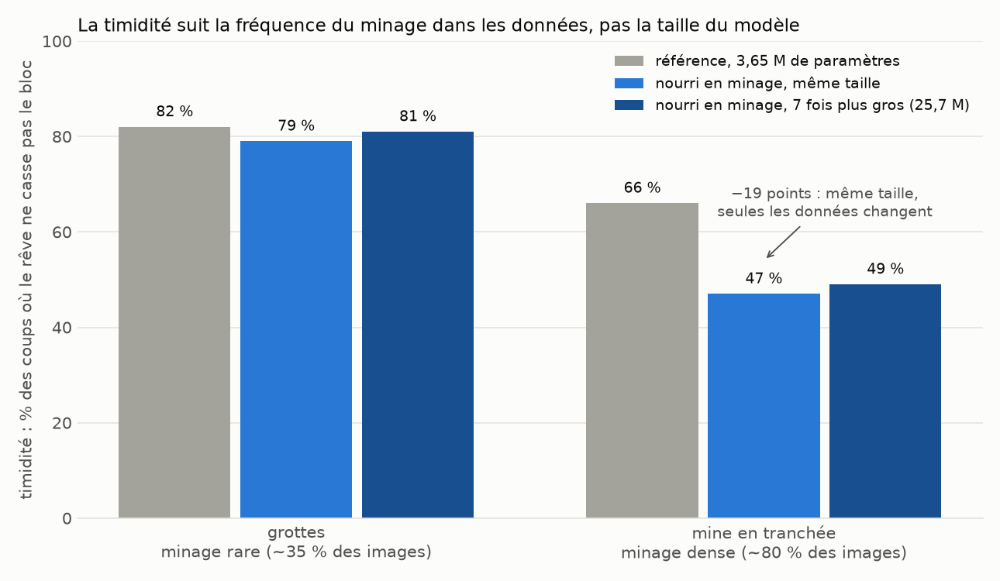
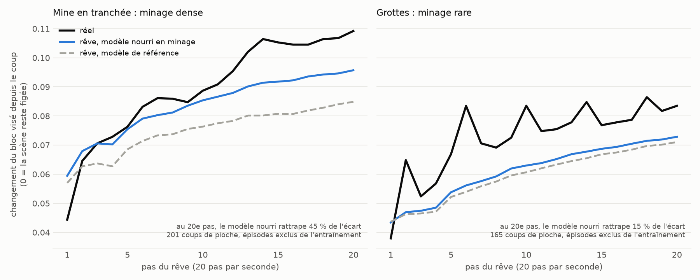
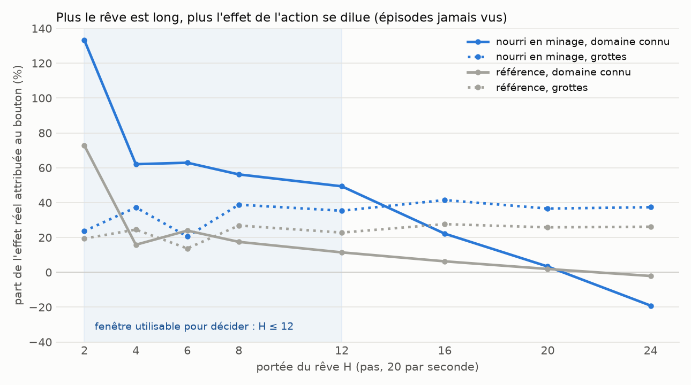
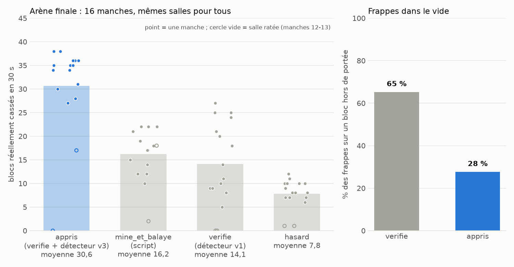

# DREAMCRAFT - un world model visuel de Minecraft

> **Projet de recherche en cours (work in progress).** Dernière mise à jour : 11 novembre 2026.
>
> Un modèle apprend à « rêver » la suite d'une partie de Minecraft. Ses rêves sont crédibles à court terme, mais ils ne suffisent pas encore pour décider où taper. En jouant au vrai jeu, un détecteur plus simple, réentraîné sur ses propres erreurs, **casse près de deux fois plus de blocs qu'un script écrit à la main**, et **coupe près de trois fois plus de bois** en forêt (section [En jeu](#en-jeu--un-agent-qui-apprend-de-ses-propres-erreurs)). Ce gain ne vient pas encore du world model. Résultats intermédiaires, pistes négatives comprises.

Un modèle qui **rêve la suite d'une partie** : à partir des dernières images et d'une action (« j'avance », « je tape »), il prédit les images suivantes. L'objectif final est qu'il se serve de ces rêves pour **décider seul** de ses actions.

<p align="center">
  
  <br><em>À gauche l'image réelle de départ, à droite le rêve du modèle sous l'action « avancer + taper ». Plus flou que le réel dès les premiers pas, il se dégrade avec l'horizon : c'est tout l'enjeu de la portée.</em>
</p>

## La question de recherche

Un world model qui ne fait que rêver ne sert à rien : il doit rêver **pour choisir**. Le projet est donc construit en deux étages :

1. **Monde 1, prédire** : `(images passées, action) → image suivante`, puis en boucle sur plusieurs pas.
2. **Monde 2, choisir** : rêver plusieurs plans candidats, noter le résultat de chacun, jouer le meilleur, recommencer.

Le levier central est la **portée `H`** : combien de pas le modèle peut rêver avant que le rêve ne devienne inutilisable pour décider.

Contraintes assumées : un seul GPU grand public (RTX 4070, 8 Go), un petit modèle (3,65 M de paramètres pour le modèle de référence) et une **évaluation qui refuse de se laisser tromper**. Chaque modèle est comparé à une règle simple, sans apprentissage : s'il ne la bat pas, il n'apporte rien.

## Le fil du raisonnement

Le projet a avancé par questions successives. Chaque réponse a posé la question suivante.

1. **Le modèle sait-il rêver la suite ?** Oui à court terme, mais il est « timide » : il refuse souvent de casser le bloc qu'on tape. La cause n'était ni la taille du modèle ni la résolution, mais le manque de minage dans les données ([section 1](#1-la--timidité--du-rêve-vient-des-données-pas-du-modèle)).
2. **Jusqu'où le rêve reste-t-il utile ?** L'effet du bouton « taper » s'y efface au-delà de 12 pas, soit 0,6 s ([section 2](#2-leffet-de-laction-sefface-avec-lhorizon)).
3. **Peut-on choisir une action avec ces rêves ?** Il y a un signal ([section 3](#3-le-choix-hors-ligne--un-signal-pas-encore-une-preuve)). Mais face à une règle simple, le rêve ne sait pas dire *où* un coup servira ([Où le rêve bloque](#où-le-rêve-bloque--savoir-où-un-coup-servira)).
4. **Est-ce la faute des vidéos ?** Pour trancher, on passe au vrai jeu : on y connaît exactement les touches envoyées, et le jeu dit lui-même ce qui a été cassé. Même là, le rêve reste sous la règle simple.
5. **Et si on posait la question directement ?** Un petit réseau qui regarde une seule image et répond « ce coup va-t-il casser un bloc ? » bat nettement la règle simple. L'agent qui s'en sert perd pourtant contre un script : le jeu montre qu'il frappe souvent trop loin.
6. **L'agent peut-il apprendre de ses erreurs ?** Réentraîné sur ses propres coups ratés, il casse près de deux fois plus de blocs que le script. La même méthode marche ensuite sur une deuxième tâche : couper du bois.

La suite logique : remettre le world model dans la décision, là où une seule image ne suffit pas, par exemple un but en plusieurs étapes.

## Lire les chiffres

- **AUC** : probabilité qu'un modèle donne un score plus haut à un cas positif (un coup qui casse) qu'à un cas négatif (un coup dans le vide). 50 % = hasard, 100 % = parfait.
- **Règle simple, ou « contraste »** : une mesure calculée sur l'image, sans apprentissage. Le contraste de la zone visée au centre de l'image, dont le sens (« haut » ou « bas » veut dire « ça casse ») est fixé sur les données d'entraînement. C'est la barre à franchir.
- **Test de signe** : on compte les manches gagnées par un joueur contre un autre, égalités retirées. Un joueur qui ne serait pas meilleur gagnerait une manche sur deux. `p` est la probabilité d'un score au moins aussi bon par pur hasard. Seuil fixé avant de jouer : p < 0,05.
- **Pas, ticks** : les vidéos et le jeu tournent à 20 images par seconde. 12 pas = 0,6 s.
- **Fixé avant** : la mesure, le seuil et la règle de réussite sont écrits avant de voir les données de test. Sinon, on finit par choisir la mesure qui arrange.

## Résultats sur vidéos

### 1. La « timidité » du rêve vient des données, pas du modèle

**Le constat.** Quand le joueur tape sur un bloc, le rêve laisse souvent la scène figée : le bloc ne casse jamais. On appelle « timidité » la part des coups où le rêve ne casse pas le bloc.

**Pourquoi c'est attendu.** Le modèle apprend en réduisant son erreur moyenne (MSE). Quand il hésite, prédire « rien ne change » est le pari le moins risqué : un bloc cassé au mauvais moment coûte plus cher qu'un bloc resté en place.

**Ce qu'on a essayé.** Pendant deux semaines, des leviers de calcul : un modèle plus gros, une résolution de 96 px, une loss dédiée. Aucun ne descend sous ~67 % de timidité. On a alors changé les données : des vidéos de minage en tranchée (*strip-mining*), où le joueur tape presque tout le temps.

<p align="center"></p>

**Le résultat.** Avec les mêmes 3,65 M de paramètres, nourrir le modèle de minage fait passer la timidité de 66 % à **47 %**. Un modèle 7 fois plus gros n'apporte rien de plus (49 %). Dans les grottes, où le minage reste rare, tous les modèles restent timides (~80 %).

<p align="center"></p>

La courbe mesure, pas après pas, combien le bloc visé change après un coup. Sur des épisodes exclus de l'entraînement, au bout de 20 pas, le modèle nourri en minage rattrape **45 %** de l'écart entre le modèle de référence et la réalité, contre **15 %** dans les grottes. Il reste sous la réalité : les bonnes données réduisent la timidité, elles ne la suppriment pas.

**Ce qu'on en conclut, prudemment.** C'est une hypothèse forte, pas une loi. Elle repose sur deux niveaux de densité seulement, et la densité est confondue avec le domaine : les vidéos de minage viennent aussi d'un autre joueur et d'un autre monde. Et les épisodes de test sont découpés dans les mêmes vidéos que l'entraînement (voir [Méthode](#méthode)).

### 2. L'effet de l'action s'efface avec l'horizon

**La question.** Pour décider, il ne suffit pas que le rêve soit crédible : il doit réagir à l'action. Si le rêve est le même qu'on tape ou non, il ne peut pas aider à choisir.

**La mesure.** Depuis la même scène, on fait rêver le modèle deux fois : une fois en tapant, une fois avec le même plan sans taper. La différence entre ces deux rêves est l'effet que le modèle attribue au bouton. On la divise par l'écart entre la réalité et le rêve sans taper : 100 % veut dire que, dans le rêve, le bouton explique tout ce qui se passe en vrai.

<p align="center"></p>

**Le résultat.** Dans le domaine connu, le rêve exagère l'effet au tout début (133 % à 2 pas). Cette part tombe ensuite à 62 % à 4 pas, à 22 % à 16 pas, puis **change de signe à 24 pas**. Dans les grottes, elle reste faible à toutes les portées.

**Ce qu'on en conclut.** Au-delà de 12 pas, le rêve a tant dérivé que l'effet du bouton s'y perd. Pour décider, la fenêtre exploitable est donc **H ≤ 12**.

### 3. Le choix hors ligne : un signal, pas encore une preuve

**L'idée.** C'est le Monde 2, testé sur des vidéos enregistrées. Pour une scène donnée, le modèle rêve six plans simples (taper, taper en avançant, avancer, ne rien faire, tourner à gauche, tourner à droite). Il note chaque rêve selon que le bloc visé disparaît : le centre de l'image change durablement, pas le décor autour. Puis il choisit le plan le mieux noté. Sur les moments où le joueur cassait vraiment un bloc, le bon choix est un plan qui tape : 2 plans sur 6, soit 33 % au hasard.

**Le résultat.** Une loss qui pénalise les rêves figés fait passer le bon choix en grotte claire de 63 % à **77 %** à H = 8.

**Pourquoi ce n'est pas une preuve.** Ce chiffre ne compte que les scènes où taper est utile : un agent qui taperait toujours ferait 100 %. La vraie question est de séparer les scènes où taper sert de celles où il ne sert à rien. Cette capacité, l'AUC d'affordance, vaut 0,70 à 0,77 selon les épisodes et baisse avec l'horizon. Il restait à la comparer à une règle simple : c'est l'objet de la section [Où le rêve bloque](#où-le-rêve-bloque--savoir-où-un-coup-servira).

### 4. Battre la copie de l'image ne suffit pas : un simple flou en fait déjà une bonne partie

**Le piège.** La référence habituelle est la copie de la dernière image, comme si rien ne bougeait. Le rêve la bat. Mais avec la MSE, une image floue coûte moins cher qu'une image nette mal placée : une copie simplement floutée, sans aucun modèle, bat déjà la copie nette. Pour savoir ce que le modèle apporte vraiment, il faut le comparer à ce flou.

| 4 épisodes, modèle v4, erreur sur les pixels qui changent | 8 à 24 pas | 48 à 80 pas |
|---|---|---|
| part du gain sur la copie nette que le meilleur flou obtient déjà | 46 à 85 % | 64 à 70 % (3 épisodes) |
| avance du rêve sur le meilleur flou | **+7 à +24 %** | **-5 à +21 %** |

**Ce qu'on en conclut.** Le rêve apporte quelque chose, mais moins que ne le suggère la comparaison à la copie nette. Et la comparaison avantage déjà la référence : le meilleur flou est choisi après coup parmi quatre. Le rêve est lui-même flou : ses détails fins (énergie haute fréquence) ne valent que 0,3 à 0,7 de ceux du réel, dès le premier pas.

La portée de 69 pas donnée dans le journal est à lire avec prudence. Elle est mesurée contre la copie nette, et elle est instable : pour le même modèle et le même épisode, elle vaut 69 pas à H = 128 et plus de 96 pas à H = 96, car les départs tirés changent. Cet épisode sert en plus à sélectionner les checkpoints.

## Où le rêve bloque : savoir où un coup servira

**La question qui compte pour un agent** : *« si je tape ici, est-ce que ça servira à quelque chose ? »*. On la pose au rêve, sur des épisodes exclus de l'entraînement, et on pose la même question à une mesure **sans aucun modèle**.

**La précaution.** L'apparence du bloc visé, sa texture, suffit déjà à deviner une partie des coups utiles : un modèle peut avoir l'air bon sans rien comprendre à l'action. On compare donc des coups où le bloc visé a la même apparence (stratification). Un premier chiffre à 84 % s'est effondré avec cette précaution : il venait de la texture. Depuis, elle est systématique.

| à apparence égale du bloc visé | AUC (50 % = hasard) |
|---|---|
| mesure simple sur les images déjà vues, sans modèle | 63,3 % |
| rêve du modèle | 64,6 % |
| effet du bouton dans le rêve (rêve en tapant moins rêve sans taper) | **46,1 %** |

*(Épisodes de grottes, hors domaine. En domaine strip, ces trois méthodes tombent à 45-53 %.)*

**Le résultat.** Le rêve ne fait qu'un point de mieux qu'une mesure triviale. Et l'effet du bouton dans le rêve ne montre **aucun signal** : sans stratification, il vaut 47,6 %, avec un intervalle de confiance à 95 % de [41,7 ; 53,5] qui contient le hasard. Autrement dit, **le modèle attribue bien un effet au bouton à court terme (section 2), mais il ne sait pas dire où ce bouton servira.**

Deux limites de ce test. L'intervalle traite chaque coup comme indépendant, alors que les coups d'un même épisode se ressemblent : il est donc trop optimiste. Et le label « le bloc visé a bougé » est en partie pollué par la caméra : son mouvement seul atteint 72 % d'AUC à apparence égale. Sur le quart des coups où la caméra bouge le moins, l'effet du bouton reste compatible avec le hasard (53,2 %, [40,8 ; 66,1]).

**D'où l'étape suivante.** Deux coupables possibles : le modèle, ou les vidéos (une partie des touches est devinée par un modèle, la caméra bouge, et « bloc cassé » se devine à partir des pixels). Dans le vrai jeu, on connaît exactement les touches envoyées, et le jeu dit lui-même ce qui a été cassé : on peut trancher.

## En jeu : un agent qui apprend de ses propres erreurs

L'agent joue à Minecraft 1.19.4 comme un humain : capture d'écran, touches et souris injectées, 20 décisions par seconde. Deux outils rendent la mesure honnête :

- **La vérité du jeu.** Un datapack écrit dans le journal du jeu, à chaque tick, le bloc visé, sa distance et chaque bloc réellement cassé. On ne devine plus un « bloc cassé » à partir des pixels : on le lit. *Pourquoi :* sur les images, le label « cassé » deviné n'est d'accord avec le jeu que 81 % du temps. Vérifiée sur 5 208 coups, la vérité donne des temps de cassage conformes aux règles du jeu.
- **Une arène à salles identiques.** À chaque manche, une salle est creusée sous terre, copiée, puis remise à l'identique avant chaque joueur. Tous partent de la même image (écart mesuré : 0 sur 255) et visent le même bloc. *Pourquoi :* sur des terrains différents, on mesurerait surtout la chance du terrain ; avec la même salle, seul le joueur change. Score : blocs réellement cassés en 30 s. L'ordre de passage tourne. Le verdict est un test de signe sur les manches, fixé avant de jouer.

### Ce que le world model n'a pas réussi

**L'idée.** Donner au modèle ce qui manquait aux vidéos : la même scène avec et sans l'action. L'agent filme des expériences contrôlées, caméra immobile : 1,5 s à regarder sans rien faire, puis 1,5 s à taper.

**Le résultat.** Réentraîné sur ces paires, le rêve prédit si un coup va casser un bloc avec une AUC de 55,5 % (42,6 % avant). La règle simple, le contraste du bloc visé, fait 75,9 %. Plus de données n'aide pas : avec 168 sessions collectées en une nuit, l'AUC reste entre 40 et 49 %. Dans les arènes, l'agent qui rêve fait à peine mieux que taper sans bouger (4,5 et 3,4 blocs, contre 2,9 et 3,0) : il tape presque tout le temps.

**Ce qu'on en conclut.** Quand plus de données ne fait rien monter, c'est la question qui est mal posée. Pour répondre oui ou non, le rêve doit prédire 12 images entières. On a donc posé la question directement.

### Ce qui marche : un détecteur appris, puis réentraîné sur ses erreurs

**L'idée.** Un petit réseau convolutif regarde **une seule image** et répond à la question : « si je tape maintenant, un bloc cassera-t-il dans les 12 ticks ? ». Une image suffit, car la réponse se lit dans la scène présente : y a-t-il un bloc à portée, au centre ? Les étiquettes viennent de la vérité du jeu. Programme fixe (15 époques, une graine), règle de réussite écrite avant : battre le contraste, avec un intervalle de confiance de l'écart au-dessus de 0.

| AUC (50 % = hasard) | détecteur | contraste, sans modèle |
|---|---|---|
| validation, 1 023 coups | **92,9 %** | 71,4 % |
| test, monde jamais vu, 155 coups | **91,1 %** | 70,2 % |
| test, terrain naturel seulement, 93 coups | 85,7 % | 74,5 % |

Les salles taillées dans un seul type de bloc sont le cas facile : le chiffre honnête est celui du terrain naturel.

**Un agent qui s'en sert.** L'agent `verifie` tape quand le détecteur dit oui ; sinon, il tourne la tête et avance. Si 12 ticks de frappe ne changent rien au centre de l'image, il s'approche, puis va chercher ailleurs. Sur 20 manches, il bat le hasard (14 manches sur 17, p = 0,006), mais pas le script `mine_et_balaye`, qui tape devant lui et tourne de temps en temps.

**Pourquoi il perd.** La vérité du jeu le montre : **68 % de ses frappes visent un bloc hors de portée**, presque toujours entre 4,5 et 8 blocs, juste trop loin. Le détecteur n'avait jamais appris cette limite : ses données venaient d'une sonde qui tape sur place, souvent face à un mur proche. Elle ne lui a presque jamais montré un bloc juste trop loin.

**Le correctif.** L'agent, lui, se met dans ces situations. Ses propres coups, étiquetés par le jeu, sont donc exactement les données qui manquaient. On réentraîne **le même réseau**, avec le même programme, en ajoutant 2 194 coups joués dans les arènes par ses versions précédentes. Les règles de l'agent ne changent pas. Sur des coups hors de portée mis de côté, l'ancien détecteur disait « ça casse » 100 % du temps, le nouveau 1 %.

<p align="center"></p>

Arène finale, 16 manches sur un terrain neuf, jouées une seule fois après le réentraînement :

| joueur | comment il joue | blocs cassés en 30 s (moyenne) |
|---|---|---|
| `appris` | comme `verifie`, avec le détecteur réentraîné | **30,6** |
| `mine_et_balaye` | script : tape devant lui, tourne de temps en temps | 16,2 |
| `verifie` | tape quand le détecteur d'origine dit oui | 14,1 |
| `hasard` | touches au hasard | 7,8 |

Manche par manche, `appris` casse plus de blocs que `verifie` 15 fois sur 15 (la 16e est une égalité à 0), que le script 15 fois sur 16 et que le hasard 15 fois sur 16. Ses deux seules défaites viennent de la même salle ratée (manche 12).

Les frappes dans le vide passent de 65 % à 28 %, et l'agent casse **près de deux fois plus de blocs que le script** (30,6 contre 16,2).

**Contre-épreuve, dans des salles fermées.** J'avais d'abord expliqué les frappes perdues de `verifie` par le tunnel qu'il creuse : il taperait sur le fond, trop loin. Il fallait le vérifier. Une seconde arène bouche les grottes autour de chaque salle. `verifie` n'y frappe presque plus trop loin (12 % des frappes) : ses frappes perdues visaient surtout les parois des grottes voisines, pas le fond de son tunnel. L'avance d'`appris` se réduit (33,7 blocs contre 27,5) mais tient : 6 manches sur 6 (p = 0,016). Contre le script, l'écart reste du simple au double (33,7 contre 16,3). Cette arène s'est arrêtée après 6 manches, sur un bug corrigé depuis : à minuit, le jeu change de journal et la vérité s'était figée.

**Limites, à lire avec le résultat :**
- `verifie` et `appris` ont été conçus après avoir vu les arènes précédentes. L'arène finale et la contre-épreuve sont les seuls tests propres.
- Deux salles sur 16 étaient mal construites, les mêmes pour tous : départ coincé dans un bloc (manche 12), salle ouverte sur une grotte inondée (manche 13). Sans elles, `appris` bat `verifie` 14 fois sur 14.
- Le réentraînement coûte un peu sur l'ancienne tâche : 91,0 % contre 92,9 % en validation (écart [-3,4 ; -0,6]), 87,8 % contre 91,1 % en test (écart non significatif).
- Sous terre, une seule tâche (casser des blocs) et un seul outil (pioche en diamant). La forêt, ci-dessous, est une deuxième tâche.
- Le world model ne sert pas à cette décision. Le gain vient de la boucle « prédire, agir, vérifier, réapprendre », appliquée à un détecteur simple.

### En surface : couper du bois

**Pourquoi une deuxième tâche.** Un résultat obtenu sur une seule tâche peut tenir à un détail de cette tâche. Si la même méthode marche aussi sur des arbres, sans retoucher les règles de l'agent, c'est bien la méthode qui marche.

**Le montage.** Un monde de forêt, une hache en diamant, et la vérité du jeu étendue aux troncs. À chaque manche, l'agent est posé sur la terre ferme, avec au moins un tronc en vue à moins de 8 blocs. Un cube de 25 blocs autour de lui, arbres compris, est copié sous la carte, puis remis à l'identique avant chaque joueur.

**Le détecteur.** C'est le même réseau, entraîné de zéro par le même programme sur 82 sessions de sonde en forêt, avec une autre question : « si je tape maintenant, un tronc cassera-t-il dans les 12 ticks ? ». Les feuilles et l'herbe, qui cassent aussi à la hache, ne comptent pas : casser des feuilles ne rapporte pas de bois.

| AUC (50 % = hasard) | détecteur bois | contraste, sans modèle |
|---|---|---|
| validation, 416 coups | **92,5 %** | 55,4 % |
| test, 260 coups enregistrés après l'entraînement | **94,5 %** | 51,5 % |

En forêt, la règle simple est proche du hasard : il faut vraiment apprendre à reconnaître un tronc. Le test a été noté avec le modèle déjà entraîné, sans le réentraîner : réussi selon la règle fixée avant.

**L'agent.** `bucheron` reprend les règles de `verifie` sans les modifier. Seuls changent le détecteur et la recherche du regard : de l'horizon vers le haut, car les troncs sont à hauteur des yeux et au-dessus, au lieu de l'horizon vers le sol sous terre. Arène de 16 manches, 60 s par joueur, règle fixée avant de jouer :

| joueur | troncs cassés en 60 s, total des 16 manches | moyenne par manche |
|---|---|---|
| `bucheron` | **55** | 3,4 |
| `mine_et_balaye` | 20 | 1,25 |
| `hasard` | 12 | 0,75 |
| `taper` | 4 | 0,25 |

`bucheron` bat le script 12 manches sur 14 décisives (p = 0,006), le hasard 13 sur 14 (p = 0,001) et `taper` 15 sur 15. Il coupe **près de trois fois plus de bois que le script**.

**Limites de la forêt :**
- Une seule arène, jouée une fois. Le test du détecteur et l'arène ont lieu dans le même monde que l'apprentissage, à d'autres endroits.
- Les départs sont moins identiques que sous terre : jusqu'à 10,6 sur 255 d'écart entre les images de départ. Sans doute le ciel, les feuilles ou les animaux, non vérifié.
- 33 % des frappes de `bucheron` tombent dans le vide (rien de visé, ou un bloc hors de portée). Sous terre, réentraîner le détecteur sur les coups de l'agent avait corrigé ce défaut. Ce n'est pas encore fait en forêt.

## Méthode

**Données**
- 234 épisodes [VPT](https://github.com/openai/Video-Pre-Training) (OpenAI, Minecraft 1.16.5) : vidéo 20 Hz et touches du joueur humain.
- 87 épisodes YouTube de joueurs en *full brightness* : grottes (1.18) et strip-mining (1.19). Leurs touches sont devinées par un **modèle de dynamique inverse** entraîné sur VPT, qui retrouve les touches en regardant 5 images consécutives, avant et après (F1 = 0,92 sur « taper »).
- Images en 64×64 (et 96×96 pour l'étude de résolution). Environ 30 Go au total, non versionnés.

**Modèle** : encodeur-décodeur convolutif à connexions de saut, contexte de 4 images. L'action est injectée par FiLM au goulot : elle module les canaux du réseau à l'endroit où l'image est la plus compressée. Entraînement en rollout : le modèle apprend sur ses propres prédictions enchaînées, avec un curriculum de K = 1 à 16 pas, une baisse du taux d'apprentissage à chaque palier, une moyenne glissante des poids (EMA) et du gradient checkpointing (mémoire constante quel que soit K).

**Évaluation** (protocole gelé avant tout entraînement, voir [docs/CADRE_DREAMCRAFT.md](docs/CADRE_DREAMCRAFT.md))
- Des **baselines d'abord** : copie de la dernière image, flux optique.
- Une erreur calculée **uniquement sur les pixels qui changent** (Δ-region). La MSE sur toute l'image récompense un rêve figé, puisque la plupart des pixels ne bougent pas.
- Sélection des checkpoints sur cette mesure, jamais sur la loss.
- Épisodes de validation exclus de tout entraînement. **Limite connue** : les épisodes strip viennent tous d'une seule vidéo, et les épisodes de grottes d'une autre. Validation et entraînement partagent donc le même joueur et le même monde, sans indépendance réelle.
- Tests **contrefactuels** (même scène, action différente) et baselines **sans modèle**, comparées à apparence égale, dont une copie floutée.
- Dix règles du jeu transformées en sondes automatiques (temps de cassage, dégâts de chute, faim…), à partir de 10 ans de pratique de Minecraft.

**En jeu** (Minecraft 1.19.4, Windows) : un monde pour apprendre, un autre pour tester. La vérité vient d'un datapack qui écrit dans le journal du jeu ; le chat est masqué pour ne pas salir les images. Chaque manche d'arène se joue sur un terrain neuf : sous terre, 60 blocs plus loin ; en forêt, environ 120 blocs plus loin, posé sur la terre ferme.

## Journal de recherche

Tout le cheminement est consigné dans [docs/JOURNAL.md](docs/JOURNAL.md) : 26 leçons, **pistes négatives comprises** (gamma simulé, montée en capacité, résolution 96 px, première tentative de données confondue). C'est le document à lire pour comprendre *pourquoi* chaque choix a été fait.

## Organisation du repo

```
src/dreamcraft/
  data/      chargement VPT, encodage des actions, fenêtres de contexte
  models/    prédicteur conv + FiLM, modèle de dynamique inverse
  eval/      métrique Δ-region, baselines (copie, flux optique)
scripts/     entraînement, évaluation, sondes, agent (index : scripts/README.md)
docs/        cadre, journal de recherche, figures
data/        données brutes et converties       (non versionné)
outputs/     checkpoints, logs, rollouts         (non versionné)
```

## Lancer le projet

Testé sous Windows 11, Python 3.11, CUDA 12.6.

```bash
python -m venv .venv
.venv\Scripts\python.exe -m pip install -r requirements.txt
```

```bash
.venv\Scripts\python.exe scripts\smoke_test_data.py
```

```bash
.venv\Scripts\python.exe scripts\build_dataset.py 20
```

```bash
.venv\Scripts\python.exe scripts\train_v7.py
```

L'entraîneur principal se configure par variables d'environnement `DC_*` (résolution, capacité, loss, sources de données) ; elles sont décrites dans l'en-tête de [scripts/train_v7.py](scripts/train_v7.py). L'agent se teste sans le jeu :

```bash
.venv\Scripts\python.exe scripts\agent_loop.py --env replay --policy chooser --steps 100
```

En jeu : Minecraft 1.19.4 ouvert sur un monde, fenêtre au premier plan. La vérité s'installe une fois, jeu fermé, avec `scripts\installe_verite.py`.

```bash
.venv\Scripts\python.exe scripts\detecteur.py
```

```bash
.venv\Scripts\python.exe scripts\arene.py --essai
```

```bash
.venv\Scripts\python.exe scripts\arene.py --manches 16 --joueurs appris,verifie,mine_et_balaye,hasard --agent appris
```

En forêt, sur un monde « Biome unique : Forêt » où la vérité est installée (`installe_verite.py dc_foret`) :

```bash
.venv\Scripts\python.exe scripts\foret.py --collecte 80
```

Puis le détecteur bois (`detecteur.py` avec `DC_LABEL=tronc_12`, commande complète dans son en-tête). Les sessions de test et l'arène s'enchaînent dans un seul processus, pour garder la fenêtre du jeu au premier plan :

```bash
.venv\Scripts\python.exe scripts\foret.py --collecte 10 --tag vt_foret --manches 16
```

Basculer sur une autre fenêtre arrête l'arène proprement. Les checkpoints ne sont pas versionnés (trop lourds) : les scripts attendent les modèles de référence dans `outputs/`. Les figures de résultats se redessinent avec `scripts\figures_readme.py` et `scripts\figure_arene.py`.

## Statut

| étape | état |
|---|---|
| Pipeline de données (VPT + YouTube + IDM) | fait |
| Monde 1 : prédiction multi-pas, bat la copie et le flou à court terme | fait |
| Timidité expliquée par la couverture de données | fait |
| Monde 2 : choix hors ligne entre plans rêvés | fait |
| Diagnostic du plafond (attribution de l'action) | fait |
| Agent sur le vrai jeu, vérité lue dans le jeu | fait |
| Paires contrefactuelles en jeu, réentraînement du world model | fait : gain réel, mais sous une mesure sans modèle |
| Détecteur appris « ce coup va-t-il casser un bloc ? » | fait : 91,1 % d'AUC sur un monde jamais vu |
| Agent qui réapprend sur ses propres erreurs, arène à salles identiques | fait : bat le script 15 manches sur 16 |
| Deuxième tâche en surface : couper du bois | fait : près de trois fois plus de troncs que le script |
| Remettre le world model dans la décision, buts à plusieurs étapes | prochaine étape |

## Crédits

- Les données d'entraînement viennent du projet [VPT](https://github.com/openai/Video-Pre-Training) d'OpenAI. Elles ne sont pas redistribuées ici : les scripts les téléchargent depuis la source.
- Le GIF et les figures montrent des images d'épisodes VPT (le GIF : `treechop-984393664dfd-20210924-174326`, un épisode jamais vu à l'entraînement).
- Minecraft est la propriété de Microsoft, ce projet n'est affilié ni à Microsoft ni à OpenAI.

## Licence

Le code est sous licence [MIT](LICENSE).

---
**Florent Baumet Dudbout**, élève-ingénieur à Centrale Méditerranée (vision, ML, PyTorch) · [LinkedIn](https://www.linkedin.com/in/florent-baumet-dudbout)
